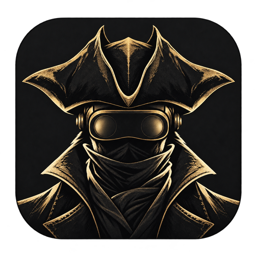

<!--
SPDX-FileCopyrightText: 2026 shadPS4 Emulator Project
SPDX-FileCopyrightText: 2026 BB-VR contributors
SPDX-License-Identifier: GPL-2.0-or-later
-->

  

# Night of the Hunt VR

An unofficial, independent VR mod for Bloodborne. No game files are included.

## Download

- [Portable (zip)](https://github.com/bldbrne-vr/bldbrne-vr/releases/latest/download/Bldbrne-VR-win-Portable.zip)
- [Installer (Windows)](https://github.com/bldbrne-vr/bldbrne-vr/releases/latest/download/Bldbrne-VR-win-Setup.exe)

## Supported game version

Bloodborne for PS4, version 1.09. Tested with CUSA03173 and CUSA00900.

## How to use

1. Install the mod (or extract the portable ZIP) and open `Bldbrne-VR.exe`.
2. Connect your headset and start your VR software.
3. Choose your **Game folder** — the Bloodborne 1.09 folder containing `eboot.bin`.
4. **Have an existing save from shadPS4?** Choose its home folder under **Saves folder (optional)**. Otherwise, skip this step: your saves stay with the mod.
5. Launch the game, put on your headset, and enjoy the hunt!

**No separate shadPS4 is needed.** The mod ships its own VR build of shadPS4 and always uses it; it is updated together with the launcher.

Weaker graphics card, or the game crashes often? Tick **Simplified Rendering** on the Play page (some AMD cards start with it on).

The first start builds the game's shaders before you play (after an update, the VR ones once more); The Old Hunters' are included if you own it. Existing saves are used in place; use **Save backups** in the launcher to back them up before playing.

## Controls

These are the default **Motion** controls with **Move with: Left stick**, using Touch-style button names (X/Y left, A/B right). For your headset's bindings, choose **Show VR controls** on the in-game VR page.

### LEFT CONTROLLER

- **Move:** push the stick. **Run:** click it while moving; centre it to stop running.
- **Jump:** while running forward, press **A** on the right controller or click the left stick again. Steering away from your run direction makes A dodge instead.
- **Shoot / parry:** aim your gun and press the trigger.
- **Quick items:** squeeze the grip to open the quick-item fan, move your hand a little toward an item to light it and use the trigger to take or use it; pull the hand away to close. With body slots enabled, grip at a pouch to take its item, or reach over your right shoulder with the left hand and grip for a Blood Vial.
- **Heal:** press **X**, then bring the vial to your wrist or body. Press X again to put it away. With **Blood Vial: Button**, X heals directly.
- **Y:** open the quick-item menu. On SteamVR's menu layout, Y opens the game menu instead; hold it to recenter.
- **Menu:** open the game menu; hold to recenter. On SteamVR, this button opens the dashboard instead.

### RIGHT CONTROLLER

- **Attack:** swing your weapon. **Heavy attack:** hold the trigger to charge, then swing. A short ring tells you a charged attack is ready.
- **Grip:** transform or prepare a physical weapon action; see the examples below.
- **Turn:** move the stick left/right. **Target / lock on:** click the stick.
- **Switch weapons:** hold the stick click and push left/right for that hand's equipped weapons.
- **Next quick item:** flick the stick down. **Blood bullets:** hold it up.
- **Dodge:** press **A**, steering with the movement stick. While running forward, A jumps.
- **Interact:** press **B** to talk, open doors or pick up items.
- **Roll:** while moving, press **A+B together**, or **B then A in quick succession**, to roll in the movement-stick direction. While locked on, this becomes a quickstep.

### Physical actions

- **Soft dodge:** lean, step or duck to move the hunter out of a blow. A quick lean, or a quick duck of at least 18 cm, also gives a moment of invincibility. This physical evasion does not play a roll animation; the separate lean-to-roll option is off by default.
- **Switch at the shoulder:** with **Shoulder weapon switch** enabled, tap **B at your right shoulder** or **Y at your left shoulder**. Hold there for about **0.4 seconds** to go unarmed; tap again to draw your weapon back.
- **Two-hand a weapon:** squeeze the right grip to free your left hand, bring the left hand to the handle, then squeeze the left grip. Release **both grips** to let go. The Whirligig Saw skips the initial right-grip squeeze.
- **Split Blade of Mercy / Rakuyo:** squeeze the right grip, grip the hilt with your left hand, then pull apart. To rejoin, bring the blades together side by side and squeeze the left grip again.
- **Physical gestures:** near the Doll, bow, point/wave, or raise a hand for rally/approval. Make Contact is also recognised; see the guide below for its pose and encounter. The corresponding gesture must be learned. Hold **Y**, then press **B** for the normal gesture menu.
- **Levers:** with **Physical levers** enabled, grip and pull with either hand.

[Full controls and weapon guide](CONTROLS.md) — weapon-specific transformations, bow use, paired blades, gestures and alternate controls.

**Using different controls?** Hold both stick clicks for one second to switch Motion / Buttons. **Move with: Right stick** swaps sticks, stick clicks and face-button actions; triggers, grips and weapon hands stay in place.

### Playing with a gamepad

Choose **Play style: Gamepad, first person** or **Gamepad, third person** on the Play page. You play with the game's own buttons; the options that need tracked hands are set for you and locked, and your motion settings come back when you switch to Motion controls. Your VR controllers keep working alongside.

- **Options:** tap for the game's menu (it also skips cutscenes). Hold 0.7 seconds to recenter; on the flat screen, hold 2.5 seconds to go back to VR.
- **First person:** the right stick turns you; hold it back to turn around.
- **Third person:** the right stick moves the camera; hold **L3** and push the right stick up or down to zoom.
- **VR settings:** the **VR** tile in the game's menu opens them, and they work with the pad: L1/R1 change tabs, L2/R2 change values.
- Xbox pads show Xbox button icons.

## Options

The launcher's **VR settings** has the same tabs as the in-game VR page, plus Graphics and Extras. Choose **Save settings**, or launch to apply changes. Defaults are for a new setup; settings you changed are kept. **Play style** and **Simplified Rendering** are on the Play page.

You

| Option | Default | What it does |
| --- | --- | --- |
| **Height** | As the hunter | As the hunter: his eye height. As the player: your real height (from the headset's floor). |
| **Adjust height** | 0 cm | Taller or shorter, from the choice above. Also corrects a floor that is a few cm off. |
| **World size (eye distance)** | Headset | A smaller eye distance makes the world look larger. |
| **Hunter's body** | Full | See the hunter's whole body, only his hands and forearms, or only his hands. |
| **Body near your eyes** | Fade | Full body only: fade his coat where it comes close to your eyes. |
| **Tracked posture** | Lean | Lean keeps the spine's length as you move your head. |
| **Skip ladder climbs** | On | Long ladders: the screen goes dark while he climbs to the end. |

Controls

| Option | Default | What it does |
| --- | --- | --- |
| **Move with** | Left stick | Which thumb walks. Also swaps stick clicks and face-button actions; your right hand still holds the blade. |
| **Turning** | Snap 30° | Turn in fixed steps (snap) or continuously (smooth). |
| **Control style** | Motion | Motion: swing to attack. Buttons: the classic layout. |
| **Stance** | Standing | Seated: smaller swings and throws, the lap counts for the vial. |
| **Vibration** | 7 / 10 | Strength of every vibration. 0 turns it off. |
| **Blood Vial** | Stab to inject | Stab the vial into your wrist, or use a button. |
| **X button** | Fan menu | Fan menu: opens and closes your quick items. Vial: readies a Blood Vial to stab. |
| **Gun laser** | Off | A thin line from the gun's barrel. |
| **Grip adjust** | On | Stand still and hold A+B for about 1.2 seconds to set how the weapon sits in your hand. |

Combat

| Option | Default | What it does |
| --- | --- | --- |
| **Solid weapons** | On | Stop at walls and each other. Weapons only: just each other. |
| **Blade sounds** | On | Your weapons ring when they meet; draw one along the other to sharpen it. |
| **Riposte burst** | On | A visceral's rip flashes the view black, red and white with ink outlines, for under a second. |
| **Ragdoll** | Normal | An enemy your blade kills goes limp at once, thrown by your swing. Off: its death animation. |
| **Two-handed controls** | Original | Optimized: the stick transforms, the left trigger grabs (hold, or toggle). |
| **Grip guide** | On | Hold the right grip to show where your left hand can grab. |
| **Flick to reload** | Wrist flick | After a shot, release the trigger and flick the muzzle up (or down sharply) to reload. |
| **VR Grab attacks** | Off | Stay in VR during enemy grabs. The view follows the hunter. |

Items & world

| Option | Default | What it does |
| --- | --- | --- |
| **Item access** | Grip + Body | No Grip: the left grip no longer opens the item menu (grabbing and holding still work). No Body: no body pouches. |
| **Quick item menu** | Fan A | Fan A (gothic panes) or B (brass): reach toward an item from where the menu opened; pull away to close. Boxes: your fist on an item picks it. |
| **Shoulder vial** | On | Reach over your right shoulder with the left hand and squeeze the grip to draw a vial. |
| **Shoulder weapon switch** | On | B at the right shoulder / Y at the left: tap to switch, hold about 0.4 seconds for unarmed. |
| **VR interactions** | Immersive | Doors and chests open, lamps light and knocks on doors are answered without pulling you out of your eyes. Flat: the hunter's own animations. |
| **Physical levers** | On | Grip a lever with either hand and pull. |
| **Lamp rest & travel** | On | Rest, refill and travel between lit lamps. Offline only. Experimental. |
| **Physical summon bell** | On | First person: B draws the bell; shake it to summon. B again cancels. |
| **Doll respec** | On | The Doll lets you move points between attributes for free at the same level (minimums 7/8/9/9/5/6). |

HUD & feedback

| Option | Default | What it does |
| --- | --- | --- |
| **Health & stamina** | Wrist gauge | On your wrist, or in the corner like the game. |
| **Low-health warning** | On | A heartbeat in both hands and dark edges when your health is low. |
| **Echoes & Insight** | Look down | Look down: they show when you look down at your feet. |
| **Hit flash** | On | The edges of your view flash red when you are hit. |
| **HUD size** | Medium | The size of the health bars, items and prompts. |
| **Low-health edges** | Medium | A red edge below 30% health; it takes priority over the exhaustion color. |
| **Exhaustion color** | On | Colors soften briefly at exhausted stamina, then fade back. |
| **Health bars** | Bosses only | Bosses only: the boss's bar near the top. All: also over enemies you hit. |

Picture

| Option | Default | What it does |
| --- | --- | --- |
| **Anti-aliasing** | SMAA | Game FXAA, dual-eye SMAA, or None. |
| **Distant detail** | Performance | Performance uses the game's simpler distant models; Balanced adds detail; Quality keeps full models at a higher cost. |
| **Contrast / Saturation / Gamma** | 0% | Light and dark separation, color intensity (-100 is monochrome) and midtone brightness. 0 is unchanged. |
| **Foveated rendering** | Auto | Less detail toward the lens edges for more FPS. |
| **Water reflections** | On | Off leaves out the scene mirrored in water for more FPS where there is water. |
| **Far shadows** | Reduced | Reduced skips the farthest shadows for more FPS in big areas. |

Difficulty

| Option | Default | What it does |
| --- | --- | --- |
| **Extra health** | +10% | More maximum health for the hunter. |
| **Longer dodge invincibility** | Off | Extra invincibility after a quickstep or roll, in 1/30-second steps. Does not apply to backsteps. |
| **Light attack stamina** | 80% | Light swing cost. Strong swings cost 100%; low stamina makes them light. |
| **Damage dealt** | 0% | Your attack damage, from -60% to +30%. |

Graphics

| Option | Default | What it does |
| --- | --- | --- |
| **Scaling** | 0% (headset resolution) | Resolution relative to what the headset requests. Higher is sharper and costs more. |
| **Upscaler** | Off | Renders smaller, then reconstructs both eyes: DLSS (NVIDIA RTX), FSR 4, FSR 4.1.2 (AMD RX 6000 and newer) or FSR 3.1.5. Applies at the next start. |
| **Quality preset** | Balanced | How small it renders before upscaling, from Ultra Performance to Ultra Quality. |
| **Foveated upscale** | Medium | DLSS or FSR works only the middle of each eye and a lighter pass smooths the edges, for more frames. Off: the whole eye. |
| **Native stereo eyes** | Auto | Multiview: the driver repeats each draw. Layers: each eye on its own, which fixes a white right eye on AMD RX 6000 cards. Auto picks for your card. |

Extras

| Option | Default | What it does |
| --- | --- | --- |
| **Camera** | First person | The starting perspective. Third person turns the VR body off. |
| **Scenes on a screen** | On | Viscerals, grabs, levers and ladders play from the game's camera on a virtual screen. Off: they stay in first person. |

The in-game VR page also has **Show VR controls**, a picture of what each button does on your controllers or gamepad.

---

## Source

A source snapshot is in [source](source).

## Affiliation and rights

Night of the Hunt VR is an independent fan project. It is not affiliated with, endorsed, sponsored, or approved by Sony Interactive Entertainment, Sony Group Corporation, FromSoftware, or the shadPS4 project.

Bloodborne and PlayStation are trademarks of Sony Interactive Entertainment. Rights in Bloodborne and its game content remain with Sony and the respective rights holders. Other names and trademarks belong to their respective owners. No ownership of those rights is claimed by this project.

No game files are included. You must provide your own lawfully obtained copy of Bloodborne. Please do not request or share game files here.

For software licences, third-party notices and attribution, see [Notices](source/NOTICE.md), [Licence](source/LICENSE) and [Credits](source/CREDITS.md).

## Thanks

Thanks to **Dirol** (dishisolo) for awesome feedback and suggestions.

Thanks to **[ID-Gamer](https://github.com/ID-Gamer)** for the third-person gamepad camera work behind the new Gamepad play styles.

Thanks to **BlizzardNight** and **Chip** for their help and support.

## Changelog

### 0.9.4

[Release notes and downloads](https://github.com/bldbrne-vr/bldbrne-vr/releases/tag/v0.9.4)

- **Play with a gamepad**: a new Play style, first or third person; your motion settings come back when you switch back.
- **The Beast Cutter swings like a heavy chain**: its reach follows your swing, and it no longer folds into your hand.
- **Hear the full charge**: the game's own charge sound when a charged attack is ready.
- **Knock on doors in VR** and **lean out of the way a little easier**.
- **More frames, fewer hitches**: about 3% faster native stereo, no freeze on arrival, fewer stutters in The Old Hunters, and fixes.

### 0.9.32

[Release notes and downloads](https://github.com/bldbrne-vr/bldbrne-vr/releases/tag/v0.9.32)

- **VR menus hold steady on Virtual Desktop**: the settings and lamp menus no longer sway the world with your head.
- **The Brain of Mensis lever works**: it uses the game's own prompt again.
- **The Amygdalan Arm snaps back cleaner**: small swings pull it straight back in, no more flailing.
- **Dodging explained** in the controls guide: lean, step aside or duck under a swing.

### 0.9.31

[Release notes and downloads](https://github.com/bldbrne-vr/bldbrne-vr/releases/tag/v0.9.31)

- **Ludwig's arena no longer crashes**: walking into the Ludwig fight could close the game.

### 0.9.3

[Release notes and downloads](https://github.com/bldbrne-vr/bldbrne-vr/releases/tag/v0.9.3)

- **The Amygdalan Arm, alive**: in whip form it lashes out to 3.5 m, grabs and hurls whatever it hits, and stabs straight ahead from a still hand.
- **Stake Driver, kicked shut**: the charged blast slams the stake back into its normal form, with a second jolt in your hand as it locks.
- **No more slowdown in long sessions**: the frame rate holds after hours and many areas.
- **Foveated upscaling on by default**: DLSS or FSR on the middle of each eye, more frames everywhere else.
- **Doors, chests and lamps in VR, and a Doll respec**: open and light them without leaving your eyes, move your stat points for free at the Doll, ladder skip on by default, a new launcher, and fixes.

Older versions: see the [releases](https://github.com/bldbrne-vr/bldbrne-vr/releases).
