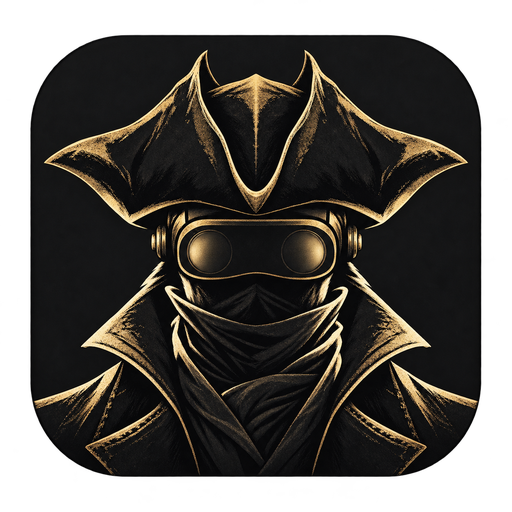

<!--
SPDX-FileCopyrightText: 2026 shadPS4 Emulator Project
SPDX-FileCopyrightText: 2026 BB-VR contributors
SPDX-License-Identifier: GPL-2.0-or-later
-->

<p align="center">
  
</p>

# Night of the Hunt VR — Linux community build

Community fork of
[Night of the Hunt VR](https://github.com/bldbrne-vr/bldbrne-vr), an
unofficial, independent VR mod for Bloodborne. This fork exists to build that
mod **natively on Linux**: the GUI launcher is Windows-only and the native
build is the working path there too (the Windows binary dies under Wine).
Verified end to end on a Valve Index through SteamVR's OpenXR runtime. No
game files are included — bring your own Bloodborne 1.09 dump (BYOD, as
upstream requires).

- **Download:** [Bldbrne-VR-linux-portable.tar.gz](https://github.com/Dr-Bongjoose/bldbrne-vr/releases/latest/download/Bldbrne-VR-linux-portable.tar.gz) — binary + `bbvr.sh` launcher
- **Build from source:** [`source/LINUX-BUILD.md`](source/LINUX-BUILD.md) (CachyOS/Arch recipe)
- **Controls:** [`CONTROLS.md`](CONTROLS.md)
- **On Windows?** This fork ships Linux only. [Official Windows releases and documentation are upstream's.](https://github.com/bldbrne-vr/bldbrne-vr/releases)

## Quick start (portable)

```sh
tar -xzf Bldbrne-VR-linux-portable.tar.gz
cd bldbrne-vr-0.9.61-linux
./bbvr.sh          # 1 dep check → 2 OpenXR setup → 3 smoke test → 4 play
```

The package is self-contained: its own VR build of shadPS4 plus the launcher,
no separate emulator install. Setup step 2 registers SteamVR as your OpenXR
runtime (SteamVR must be installed and launched at least once — it ships the
runtime) and applies the SteamVR stability trims: frunk camera and desktop
mirror off, known NVIDIA compositor-crash triggers, reversible in
`steamvr.settings` (see [`source/LINUX-BUILD.md`](source/LINUX-BUILD.md)). The
first run asks for your Bloodborne 1.09 dump folder (the one containing
`eboot.bin`) and remembers it. Config and saves live in `~/.local/share/shadps4/`;
more detail sits in `README-LINUX.txt` inside the package.

Newest release: [v0.9.61-linux.2](https://github.com/Dr-Bongjoose/bldbrne-vr/releases/tag/v0.9.61-linux.2) —
each release's notes list the packed binary's sha256.

**Tested on:** CachyOS (Arch-based) · NVIDIA 620.70.06 · SteamVR 2.19.3 · Valve
Index. Other distros and headsets are untested.

## Controls

These are default **Motion** controls with **Move with: Left stick**, using
Touch-style button names (X/Y left, A/B right): swing to attack, trigger to
shoot or parry, lean or duck to dodge physically, **A** to dodge, **B** to
interact. For your headset's actual bindings, choose **Show VR controls** on
the in-game VR settings page.

[Full controls and weapon guide](CONTROLS.md) — weapon transformations, bow
use, paired blades, gestures, gamepad play styles and alternate layouts.

## Windows

This fork is Linux-only. The official Windows installer and portable ZIP —
with the full Windows documentation (`Bldbrne-VR.exe`, launcher saves, the
`Simplified Rendering` and save-backup workflow) — live upstream:

[bldbrne-vr/bldbrne-vr releases](https://github.com/bldbrne-vr/bldbrne-vr/releases)
([portable ZIP](https://github.com/bldbrne-vr/bldbrne-vr/releases/latest/download/Bldbrne-VR-win-Portable.zip) ·
[installer](https://github.com/bldbrne-vr/bldbrne-vr/releases/latest/download/Bldbrne-VR-win-Setup.exe))

## Build from source

The full recipe — externals, Clang configuration, OpenXR runtime
registration, the `--benchmark-headset` smoke test and NVIDIA SteamVR
stability notes — is [`source/LINUX-BUILD.md`](source/LINUX-BUILD.md). Short
version (Arch/CachyOS):

```sh
sudo pacman -S --needed git cmake clang ninja openxr

git clone https://github.com/Dr-Bongjoose/bldbrne-vr
cd bldbrne-vr/source
git submodule update --init --recursive
for d in externals/*/; do [ -f "$d/.gitmodules" ] && git -C "$d" submodule update --init --recursive; done

cmake -B build-clang -G Ninja -DCMAKE_C_COMPILER=clang -DCMAKE_CXX_COMPILER=clang++ \
  -DCMAKE_BUILD_TYPE=Release -DBUILD_WITH_SYSTEM_JSONCPP=OFF
ninja -C build-clang shadps4

"$HOME/.local/share/Steam/steamapps/common/SteamVR/bin/linux64/vrpathreg" setthis   # once
build-clang/shadps4 --benchmark-headset=/tmp/headset.json    # smoke test, exits by itself
build-clang/shadps4 --openxr /path/to/Bloodborne-1.09-dump   # play
```

First build ~35 min; later updates are incremental (~minutes per pass). The
whole source tree, including the mod's own code, is in [`source/`](source).

## What this fork changes

On top of upstream 0.9.61 — the port is documented in
[the upstream PR](https://github.com/bldbrne-vr/bldbrne-vr/pull/41) and
[`source/LINUX-BUILD.md`](source/LINUX-BUILD.md):

- Native Linux build fixes, all cross-platform safe (Windows never compiles
  the Linux paths): MSVC-vs-glibc type identity, the dead non-Windows stub in
  `write_watch.cpp`, X11 atom-macro collisions with engine enum members.
- [`source/linux-portable/`](source/linux-portable) — the `bbvr.sh` launcher
  and `make-package.sh` packaging behind the release tarball.
- [`source/LINUX-BUILD.md`](source/LINUX-BUILD.md) — the build guide.

## Game version

Bloodborne for PS4, version 1.09. Tested with CUSA03173 and CUSA00900. No
game files are included, provided or accepted anywhere in this project.

## Settings

Linux has no GUI launcher (that is upstream's Windows tooling), so this fork
does not carry the launcher's options tables — the in-game **VR settings**
page contains almost all of them, and
[upstream's README](https://github.com/bldbrne-vr/bldbrne-vr#options)
documents the launcher itself. Linux specifics (config, saves, trims) are in
`README-LINUX.txt` inside the release package.

## Releases

- This fork's Linux builds: [fork releases](https://github.com/Dr-Bongjoose/bldbrne-vr/releases) —
  `Bldbrne-VR-<version>-linux-portable.tar.gz`, sha256 in the notes.
- Upstream Windows releases and their changelog:
  [bldbrne-vr/bldbrne-vr releases](https://github.com/bldbrne-vr/bldbrne-vr/releases).

## Credits

Night of the Hunt VR (Bldbrne-VR) is by
[pkalogiros and bldbrne-vr contributors](https://github.com/bldbrne-vr/bldbrne-vr);
this fork would not have anything to port without it. Thanks to upstream's
testers — **Dirol** (dishisolo), **BlizzardNight** and **Chip** — and to
**[ID-Gamer](https://github.com/ID-Gamer)** for the third-person gamepad
camera work.

## Affiliation and rights

Night of the Hunt VR is an independent fan project. It is not affiliated with, endorsed, sponsored, or approved by Sony Interactive Entertainment, Sony Group Corporation, FromSoftware, or the shadPS4 project.

Bloodborne and PlayStation are trademarks of Sony Interactive Entertainment. Rights in Bloodborne and its game content remain with Sony and the respective rights holders. Other names and trademarks belong to their respective owners. No ownership of those rights is claimed by this project.

No game files are included. You must provide your own lawfully obtained copy of Bloodborne. Please do not request or share game files here.

For software licences, third-party notices and attribution, see [Notices](source/NOTICE.md), [Licence](source/LICENSE) and [Credits](source/CREDITS.md).
